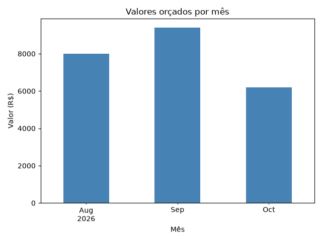

# Análise de orçamentos de esquadrias

Mini projeto para treinar análise de dados com Python e pandas, usando um cenário que conheço do meu trabalho: orçamentos de janelas, portas e painéis de vidro/alumínio.

https://paulomellog.github.io/analise-orcamentos-esquadrias/

> Os dados são fictícios.

## Perguntas que a análise responde
1. Quanto foi orçado no total e por tipo de produto?
2. Qual a taxa de aprovação dos orçamentos (e por tipo de vidro)?
3. Como o valor orçado evoluiu mês a mês?

## Como rodar
```bash
pip install pandas matplotlib
python analise.py
```

## Conclusões
**Total**

No total, foram orçados R$ 23.592,20 em esquadrias, se dividindo em:
1. R$ 13.818,00 em **painéis** (cerca de 59% do valor total, com apenas 7 orçamentos).
2. R$ 5.306,40 em **janelas**.
3. R$ 4.467,80 em **portas**.

**Aprovações**

A taxa de aprovação geral é de 62,5%. Os mais aprovados são os que possuem vidro **laminado** (85,7%), seguido dos **temperados** (62,5%) e **comum** (44,4%).

OBS: Os 3 orçamentos pendentes foram contados como não aprovados.

**Valores por mês**

É possível notar um aumento pontual no valor dos orçamentos no mês de **setembro** (R$ 9.404,60) enquanto **agosto** (R$ 7.987,20) e **outubro** (R$ 6.200,40) ficam atrás.

<p align="center">
    
    <br>
    <em>Valor orçado por mês</em>
</p>

## Página de resultados
Para gerar a página com identidade visual (HTML + CSS, abre direto no navegador):
```bash
python gerar_relatorio.py
```

## Tecnologias
Python, pandas, matplotlib, Git/GitHub
