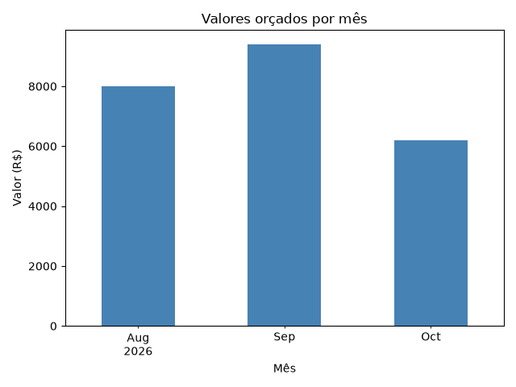

# Análise de orçamentos de esquadrias

Projeto para treinar análise de dados com Python e pandas, usando um cenário que conheço do meu trabalho: orçamentos de janelas, portas e painéis de vidro/alumínio. A análise virou um painel interativo, feito com Streamlit, onde é possível explorar os dados, simular o valor de uma esquadria e ver o código por trás de cada resultado.

> Os dados são fictícios.

## Painel interativo
**Link do painel:** *em breve*

O painel é somente de leitura: os dados vêm do `orcamentos.csv` e ninguém cadastra nem altera nada.

- **Painel:** indicadores (total orçado, quantidade, ticket médio e taxa de aprovação), gráficos por produto, por tipo de vidro e por mês, e a tabela de orçamentos. Os filtros da lateral (status, produto, vidro e mês) recalculam tudo.
- **Calculadora:** simula o valor de uma esquadria de vidro a partir do tipo de vidro, da largura, da altura e da quantidade, mostrando a conta passo a passo. Nada é salvo.
- **Como foi feito:** mostra o código real de cada passo da análise, com a explicação.
- **Qualidade dos dados:** ao carregar o CSV, o painel avisa se houver campos vazios, números repetidos, opções inválidas ou medidas zeradas.

## Perguntas que a análise responde
1. Quanto foi orçado no total e por tipo de produto?
2. Qual a taxa de aprovação dos orçamentos (e por tipo de vidro)?
3. Como o valor orçado evoluiu mês a mês?

## Como rodar
Instale as bibliotecas:
```bash
pip install -r requirements.txt
```

Abra o painel interativo:
```bash
python -m streamlit run app.py
```

Rode a análise pelo terminal (gera o `grafico.png`; precisa também do matplotlib):
```bash
pip install matplotlib
python analise.py
```

## Estrutura do projeto
| Arquivo | O que faz |
|---|---|
| `app.py` | A tela do painel (Streamlit) |
| `dados.py` | Leitura, checagem e análises com pandas, sem Streamlit |
| `calculos.py` | Regras de cálculo: área, valor e tabela de preços do vidro |
| `analise.py` | A análise original, rodada pelo terminal |
| `orcamentos.csv` | Os dados (fictícios) |
| `requirements.txt` | Bibliotecas usadas pelo painel |

## Conclusões
**Total**

No total, foram orçados R$ 23.592,20 em esquadrias, se dividindo em:
1. R$ 13.818,00 em **painéis** (cerca de 59% do valor total, com apenas 7 orçamentos).
2. R$ 5.306,40 em **janelas**.
3. R$ 4.467,80 em **portas**.

**Aprovações**

A taxa de aprovação geral é de 62,5%. Os mais aprovados são os que possuem vidro **laminado** (85,7%), seguido dos **temperados** (62,5%) e **comum** (44,4%).

OBS: Os 3 orçamentos pendentes foram contados como não aprovados.

**Valores por mês**

É possível notar um aumento pontual no valor dos orçamentos no mês de **setembro** (R$ 9.404,60) enquanto **agosto** (R$ 7.987,20) e **outubro** (R$ 6.200,40) ficam atrás.

<p align="center">
    
    <br>
    <em>Valor orçado por mês</em>
</p>

## Tecnologias
Python, pandas, Streamlit, matplotlib, pytest, Git/GitHub
